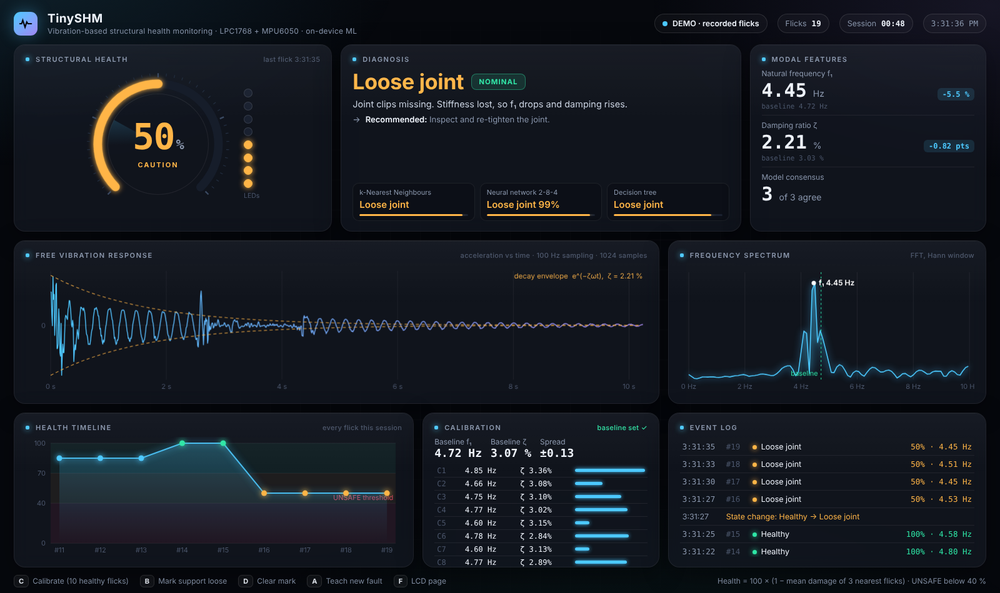

# TinySHM: Vibration-Based Structural Damage Detection on an ARM Cortex-M3

[](https://github.com/HalcyonVector/TinySHM/actions/workflows/pages.yml)

Flick a steel cantilever beam and an LPC1768 (ARM Cortex-M3, no FPU) tells you what is wrong with it: healthy, added mass, loose joint or loose support, plus a 0 to 100 health score, a change alarm and an "unknown fault" flag. An MPU6050 accelerometer records the free vibration at 100 Hz, the board runs its own FFT and damping estimate, and a decision tree, k-nearest neighbours and a 5-8-4 neural network trained on a laptop run on the chip as plain C. Pressing **C** on the keypad and flicking ten times sets the healthy baseline, so the same model works on a new board or a re-assembled beam without retraining. Everything fits in about 21 KB of flash, inside the free Keil 32 KB limit.

> **Live demo:** [halcyonvector.github.io/TinySHM](https://halcyonvector.github.io/TinySHM/): the lab dashboard replaying real recorded flicks (calibration, coin, loose joints), served from GitHub Pages. No board needed.



---

## Findings

Real numbers from 131 flicks recorded in the lab over two days on two different LPC1768 boards, not simulations:

- **ML beats the classical frequency rule.** 5-fold cross-validation repeated 5 times: decision tree **88.6%**, neural network **87.3%**, kNN **85.7%**, against **78.0%** for a frequency-only rule.
- **Damping sees what frequency cannot.** Added mass drops f1 by about 22% and loose joints by 5 to 8%, but a loosened support barely moves f1; only damping rises. The tree splits on damping 55% of the time and frequency 40%.
- **Calibration fixes board-to-board drift.** The second board read the same healthy beam at 4.39 Hz instead of 4.74 Hz. With every feature taken relative to the 10-flick C baseline, the relative shifts per fault are the same on both boards and one model serves both.
- **Health score tracks severity.** kNN health regression errs by 10.1 points on average, against 24.8 for linear regression. Healthy reads 100, a coin about 85, one missing clip about 50, two missing clips about 0 (UNSAFE).
- **Board equals PC.** The firmware C code, compiled on a laptop, gives the same features, classes and health (within 0.03 points) as the Python reference on every recording.
- **An honest limit.** Loosening the clamp by 1/4 or 1/2 turn stays inside the healthy range, so it is not reliably detected (5 of 13 and 2 of 12 held-out flicks flagged). Key **B** lets an operator mark the support loose by hand.
- **Fewer features scored higher, and that is reported.** Using only f1 and damping gives kNN 96.0% and a 4.3-point health error, because amplitude and decay time vary with how hard the beam is flicked. The project keeps all five as its design choice.

---

## Disclaimer

University lab project (Embedded Systems Lab, Manipal Institute of Technology), not a certified structural health monitoring product. Results come from one hand-flicked ruler beam in one room. Do not use it to judge the safety of a real structure.

---

## Features

### On the Board (LPC1768)

- MPU6050 read over bit-banged I2C at about 15 kHz, Z axis, +-4 g, built-in 44 Hz filter
- Flick detection (0.3 g threshold) and 1024 samples at 100 Hz from Timer0
- Own radix-2 FFT with Hann window and parabolic peak interpolation (0.009 Hz mean error, 117 ms on the chip)
- Log-envelope damping, peak amplitude, energy outside the main peak and decay time
- Decision tree, kNN (k = 3) and 5-8-4 neural network from an auto-generated `model.h`
- Health score, change detector, novelty (UNKNOWN) detector
- 16x2 LCD, 8-LED health bar (all flash when UNSAFE), 4x4 keypad, UART report every flick

### Keypad

| Key | Action |
|---|---|
| `C` | Calibrate: next 10 flicks become the healthy baseline (median) |
| `B` | Mark support loose (health capped at 50%) |
| `D` | Clear the mark |
| `A` | Teach a new fault from 5 flicks (counts as 50% damage) |
| `F` | Switch LCD between the answer and the raw numbers |
| `0` | Back to normal run mode |

### On the Laptop

- Logger that walks the whole lab plan (`--plan`) and resumes from saved files
- Training, cross-validation, plots and C export in one command
- C-to-Python parity check that compiles the firmware with gcc
- Trend forecast: when will health cross the UNSAFE line
- LLM-written inspection report (Groq, Gemini fallback, or a built-in template)
- Live browser dashboard over the board's serial output, works offline

---

## Tech Stack

| Layer | Technology | Details |
|-------|-----------|---------|
| MCU | NXP LPC1768 | ARM Cortex-M3, 100 MHz, ALS-SDA-ARMCTXM3-01 lab board |
| Sensor | MPU6050 (GY-521) | 3-axis MEMS accelerometer over I2C |
| Firmware | C (C89) | Keil uVision 4, or arm-none-eabi-gcc (`board/gcc/build.sh`) |
| Flashing | Flash Magic | Over the board's serial port, JP3 jumper for auto ISP |
| ML training | Python, scikit-learn | Tree, kNN, MLP, exported as C arrays |
| Signal processing | NumPy | Same FFT and features as the board |
| Dashboard | Vanilla HTML/CSS/JS + Python `http.server` | Server-sent events, no framework, no internet |
| Hosting | GitHub Pages | Static replay demo deployed by GitHub Actions |
| Report | IEEE conference format | Word + PDF in `docs/final_report/` |

---

## Hardware

About Rs 1,100 on top of the lab board. No drilling, cutting or workshop tools.

| Part | Use |
|---|---|
| 2 x 30 cm steel rulers | The beam: ruler A 18.5 cm past the table edge, ruler B overlapping it by 13.5 cm (35.5 cm free length) |
| 3 binder clips | Hold the two rulers together; removing clips = loose joint |
| 10 inch screw G-clamp + cardboard pad | Holds ruler A to the table; loosening it = loose support |
| Rs 20 + Rs 5 coin | Added mass, taped at the 28 to 30 cm mark |
| MPU6050 (GY-521) | Taped flat on ruler B, about 26 cm from the edge |
| Female-to-female jumpers | Sensor to board |

### Wiring

| What | Connection |
|---|---|
| MPU6050 SDA | CNC pin 5 (P0.19) |
| MPU6050 SCL | CNC pin 6 (P0.20) |
| MPU6050 VCC / GND | TP2 "3.3V" / TP3 "GND" |
| LCD | FRC CND to CNAD, short JP16 and JP5 |
| Keypad | FRC CNB to CNB3, short JP4 (1,2) |
| LEDs | FRC CNA to CNA1 |
| PC link | DB9 to CN9, 19200 baud |

Photos and every step are in [docs/BUILD_GUIDE.md](docs/BUILD_GUIDE.md).

---

## Prerequisites

- Python 3.10+ (`py` on Windows)
- For the board: Keil uVision 4 or arm-none-eabi-gcc, and Flash Magic
- Optional: gcc for the parity check, a free [Groq](https://console.groq.com) key for LLM reports

---

## Quick Start

### Dashboard without a board

```
git clone https://github.com/HalcyonVector/TinySHM.git
cd TinySHM
py -m pip install -r requirements.txt
py pc/dashboard_web.py --demo
```

### With the board

1. Flash `hex/TinySHM.hex` with Flash Magic (JP3 cap on), close Flash Magic, take JP3 off and press RESET.
2. Start the dashboard on the board's COM port:
   ```
   py pc/dashboard_web.py --port COM3
   ```
3. Press **C** and flick the beam 10 times, then flick it after each change.

---

## Usage

```
py pc/logger.py --port COM3 --plan     # record every lab condition, resumes where it stopped
py pc/build_dataset.py real            # flick files -> features table (per-day baseline)
py pc/train.py real                    # train, cross-validate, plot, write board/model.h
py pc/check_c_parity.py real           # firmware C == Python on every flick
py pc/compare_methods.py real          # FFT peak vs interpolated FFT vs zero-crossing
py pc/trend.py real                    # predicted step at which health goes UNSAFE
py pc/llm_report.py real               # LLM inspection report (GROQ_API_KEY)
py pc/build_pages.py                   # rebuild the GitHub Pages demo
```

Then rebuild the firmware (`board/gcc/build.sh`, or Keil with `board/*.c`) and reflash.

---

## How It Works

1. **Flick:** the board waits for the acceleration to move 0.3 g from rest, then records 10.24 s.
2. **Features:** windowed FFT with interpolated peak gives f1; the slope of the log RMS envelope gives damping; amplitude, energy ratio and decay time complete the five.
3. **Calibrate:** each feature is divided by (f1, amplitude, decay) or offset from (damping, energy) the median of the ten C flicks.
4. **Classify:** tree, kNN and neural network vote on the class; kNN over labelled damage levels gives health.
5. **Alarm:** health below 40 is UNSAFE; a flick far from all training data is UNKNOWN.
6. **Report:** LCD, LEDs and a `RES,...` + `RAW,...` line over UART for the logger and dashboard.

The full method, equations and results are in the [final report](docs/final_report/TinySHM_Report.pdf).

---

## Project Structure

```
TinySHM/
├── board/                Firmware: main.c, hw.c (drivers), features.c (FFT), classify.c, model.h
│   └── gcc/              arm-none-eabi-gcc build script and linker file
├── hex/                  Ready-to-flash builds (TinySHM.hex and lab test programs)
├── Keil/                 Keil uVision 4 project
├── pc/                   Python: logger, features, training, C export, parity, dashboard, reports
├── pages/                Static dashboard demo for GitHub Pages (built by pc/build_pages.py)
├── data/real/            131 recorded flicks (raw samples) + real_log.csv
├── results/real/         Metrics, plots and trained models
└── docs/                 Build guide, lab day checklist, final report, reference PDFs
```

---

## Known Limitations

- 131 flicks from one beam in one room; temperature and long-term drift were not studied
- Flicks are by hand, so amplitude varies; a mechanical exciter would give cleaner data
- Support loosening under about 3/4 turn is not reliably detected
- Why the second board reads a lower frequency for the same beam is unknown; calibration hides the offset but does not explain it
- Only the first bending mode is used

---

## Project Stats

| Metric | Value |
|--------|-------|
| Recorded flicks | 131 (2 days, 2 boards) |
| Fault classes | 4 |
| Features | 5 |
| Models on the chip | 3 classifiers + health + change + novelty |
| Flash used | ~21 KB of 32 KB |
| References in the report | 15 |

---

## Authors

**Sagnik Basu**, **Pranav Gaddam**, **Shobit Hegde**, Section CCE A, School of Computer Engineering, Manipal Institute of Technology

GitHub: [@HalcyonVector](https://github.com/HalcyonVector)

---

## License

MIT License, see [LICENSE](./LICENSE).
