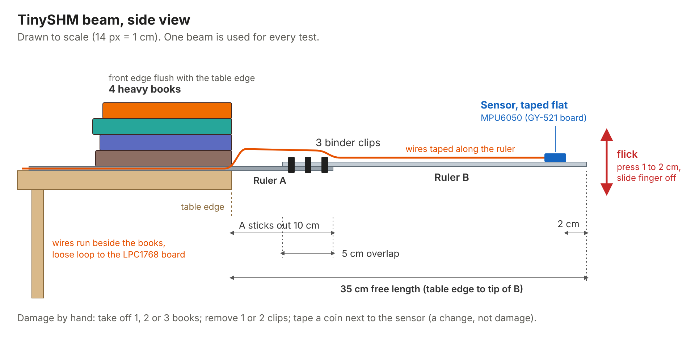
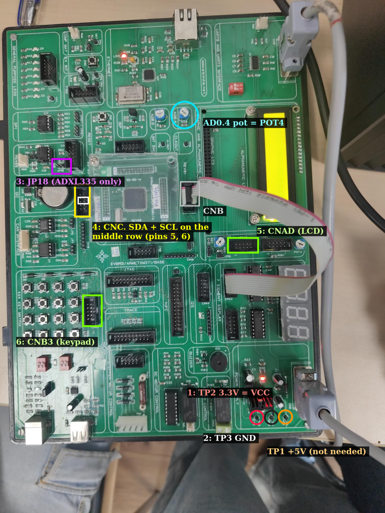
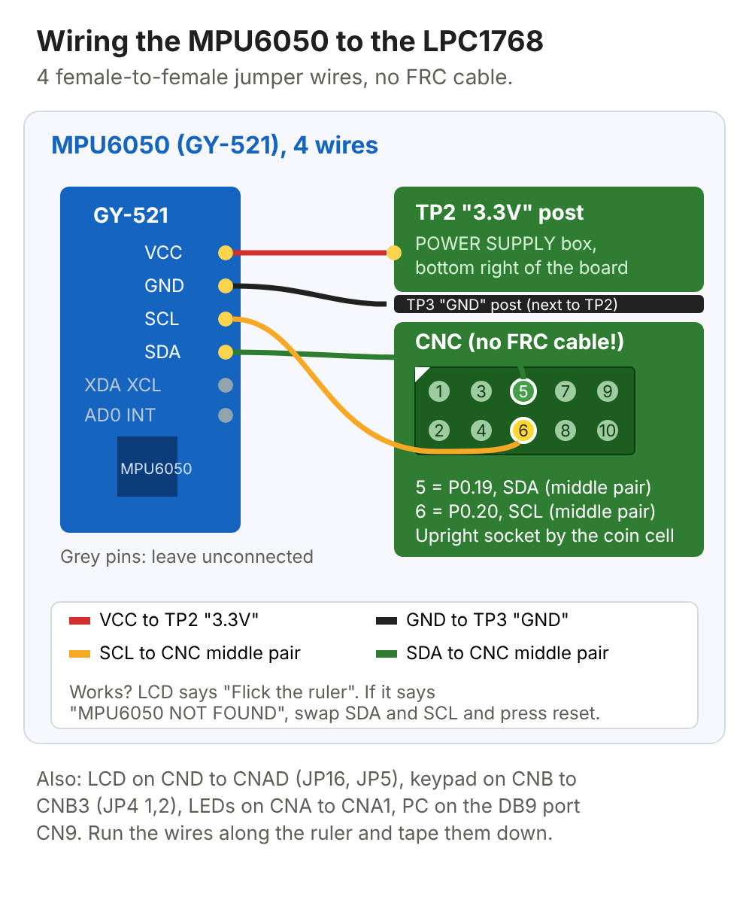

# TinySHM build guide: from shopping bag to demo

Everything here is done by hand. No drilling, cutting or soldering.

## What you need

- 2 steel rulers, 30 cm, same brand (plus 1 spare)
- 1 screw C-clamp (G-clamp), 3 or 4 inch: a metal "C" with a threaded screw
  and a T-handle that you turn by hand. No nails, no hammer, no holes: it just
  squeezes the ruler onto the table edge. A screw F-clamp (bar clamp) does the
  same job. No clamp at all? Use 4 heavy books (see the note in Part 1)
- 3 binder clips, 25 mm or 32 mm
- Thin double-sided tape and insulation tape
- An MPU6050 sensor module (GY-521 board) with headers **already soldered**
- 4 female-to-female jumper wires (plus spares)
- A coin, a pen, and the lab's LPC1768 board, PC, Keil and Flash Magic

## Part 1: Build the beam

You build **one** beam and use it for every test. Never rebuild it between
tests, because the board learns what this exact beam sounds like.



1. **Clamp ruler A.** Lay it flat on the table with 10 cm sticking out past
   the edge (20 cm stays on the table). Put the C-clamp over the part still on
   the table, about 2 cm from the edge, and tighten it firmly by hand. Draw a
   pen line on the table along the ruler and at the clamp, so you can put
   everything back in the same place. Put a folded piece of cardboard or
   cloth between the clamp's lower jaw and the underside of the table so it
   can't mark the table.

   **No C-clamp yet?** Stack 4 heavy textbooks on the part of ruler A that is
   on the table, with the front of the stack exactly flush with the table
   edge, and mark where they sit. Everything else stays the same. For the
   "loose support" fault, take off 1, 2 or 3 books instead of loosening the
   clamp. Pick one method and use it for all your recordings.
2. **Join ruler B.** Lay ruler B on top of the free end of ruler A so they
   overlap by 5 cm, both pointing the same way. Ruler B's tip should be 35 cm
   from the table edge.
3. **Clip the joint.** Put 3 binder clips across the overlap, spread evenly
   (one near each end of the overlap, one in the middle). Fold the clip
   handles flat or take the metal handles off, so they don't rattle.
4. **Check it.** Flick the tip gently. It should ring for several seconds
   with a clean "boing". If it buzzes or clatters, push the clips on
   harder and tighten the clamp.

Keep these lengths: they put the vibration at roughly 6 to 8 times a second
(an estimate; you'll measure the real value). A much longer beam droops and
vibrates too slowly to measure well. Measure with the ruler markings and
write the numbers down so you can rebuild it the same way.

## Part 2: Stick on the sensor

1. Put a small square of double-sided tape on the back of the GY-521 board
   (the side without the chip).
2. Press it flat onto ruler B, about 2 cm from the tip, with the pins
   pointing back toward the table. The chip's flat face must be parallel to
   the ruler.
3. Wrap one turn of insulation tape over the module and around the ruler,
   so it can't peel off when you flick.

## Part 3: Wire the sensor to the board

**Important: no FRC ribbon cable for the sensor.** An FRC cable only joins
one 10-pin socket to another 10-pin socket (like CND to CNAD for the LCD).
The sensor module has single pins, so it connects with **loose
female-to-female jumper wires**, one wire per pin. The FRC cables are only
for the LCD and the keypad.

### Where everything is on the lab board



| Mark on the photo | What it is | Used for |
|---|---|---|
| 1: TP2 "3.3V" | Small black test post in the POWER SUPPLY box, bottom right | Sensor VCC |
| 2: TP3 "GND" | The post right next to TP2 | Sensor GND |
| TP1 "+5V" | Third post | Not needed |
| 3: CNC | The upright 10-pin socket to the left of the clear processor cover, beside the coin cell | SDA and SCL on the **middle pair** of pins (pins 5 and 6) |
| CNB | The socket on the right of the processor cover (where the ribbon is in the photo) | Keypad cable (CNB to CNB3) |
| 4: CNAD | Socket just under the LCD, next to POT2 | LCD cable (CND to CNAD) |
| 5: CNB3 | Socket to the right of the 4x4 keys | Keypad cable |

TP2 and TP3 are test posts, not header pins. If a female jumper end doesn't
grip them firmly, use a small crocodile-clip lead (about Rs 50 for a pack).

### The wiring: 4 wires



1. Leave CNC empty: no FRC cable in it.
2. Take 4 female-to-female jumper wires. Push one end of each onto the
   GY-521's **VCC**, **GND**, **SCL** and **SDA** pins.
3. Push the other ends on like this:

| GY-521 pin | Goes to |
|---|---|
| VCC | **TP2 "3.3V"** |
| GND | **TP3 "GND"** |
| SDA | **CNC, middle pair**, pin 5 (P0.19) |
| SCL | **CNC, middle pair**, pin 6 (P0.20), beside SDA |
| XDA, XCL, AD0, INT | Leave unconnected |

The black plastic box around CNC is only a guide. The jumper ends slide in
side by side onto the metal pins inside it. Pins in a 10-pin socket go in
pairs (1-2, 3-4, 5-6, 7-8, 9-10), so pins 5 and 6 are always the middle pair,
whichever way up the socket is. If the LCD says **MPU6050 NOT FOUND**, swap
the SDA and SCL wires and press reset.

### Wire routing and other connections

**Wire routing:**
- Tape the wires along the ruler with small pieces of insulation tape,
  running back toward the clamp.
- Leave a loose loop of wire between the clamp and the board, so the wires
  never pull on the beam.
- Tape the wires down on the table just behind the clamp, so the hanging
  part doesn't swing.
- Keep the wiring exactly the same for all tests. Wires add a little weight.

**Other board connections** (same as your lab experiments, these DO use FRC cables):
- LCD: FRC cable from CND to CNAD, short JP16 and JP5. Use POT3 if the text
  is invisible.
- Keypad: FRC cable from CNB to CNB3, short JP4 (1,2).
- PC: DB9 cable to CN9, plus the board's power cable.
- LEDs (health bar and alarm): FRC cable from CNA to CNA1, as in Lab 6.
  The 8 LEDs LD2 to LD9 light up as a health bar (8 lit = 100 %). They all
  flash for UNSAFE, and flash in an alternating pattern for UNKNOWN. If you
  skip this cable, everything else still works.

## Part 4: Load the code

1. In Keil uVision 4, create a project for the NXP LPC1768, as in Lab 6.
   Add `system_LPC17xx.c`, plus `board/main.c`, `hw.c`, `features.c` and
   `classify.c`. Tick "Create HEX file".
   **Stack size:** open `startup_LPC17xx.s`, click the "Configuration
   Wizard" tab at the bottom, and set Stack Size to `0x00000800` (2 KB).
   The default 0x200 (512 bytes) is too tight for the ML code. Then build.
2. Flash the HEX with Flash Magic, as in Lab 6.
3. **Close Flash Magic** (it holds the COM port), then press reset on the
   board.
4. Look at the LCD:
   - **DAMAGE DETECTOR / Flick the ruler** means the sensor is talking to
     the board. Go on to Part 5.
   - **MPU6050 NOT / CHECK WIRING** means no reply. Swap the SDA and SCL
     wires, check VCC and GND, and press reset. If it still fails, try the
     other two CNC pins next to them.

## Part 5: First flick

Flick by pressing the tip down about 1 to 2 cm with one finger, then sliding
your finger off sideways. Do it the same way every time. The board records
for about 10 seconds, then shows the answer and the health score on the LCD.
Don't touch the beam or the table while it records.

It will guess using the practice model trained on fake data, so don't trust
the answer yet. You're only checking that something appears.

## Part 6: Record real data

On the laptop, with the board connected (change `COM5` to your port, which
is under Ports in Device Manager):

```
python pc/logger.py --port COM5 --label healthy --step 0 --count 25
```
Flick, wait until the logger prints that it saved the flick (about 12
seconds), then flick again, until it reaches the count. Then make each
change by hand and
record it, putting the beam back to healthy after each fault:

| Condition | What to do by hand | Command (label, step, count) |
|---|---|---|
| Healthy | Nothing: clamp tight, 3 clips on | `healthy 0 25` |
| Coin | Tape a coin on ruler B next to the sensor | `added_mass 1 25` then remove the coin |
| Loose joint 1 | Remove the middle clip | `loose_joint 1 15` |
| Loose joint 2 | Also remove one end clip (1 left) | `loose_joint 2 12` then put both back |
| Loose support 1 | Loosen the clamp a 1/4 turn (or take 1 book off) | `loose_support 1 12` |
| Loose support 2 | Loosen to 1/2 turn (or 2 books off) | `loose_support 2 12` |
| Loose support 3 | Loosen to 3/4 turn, beam still held (or 3 books off) | `loose_support 3 10` then tighten again |

Each row means
`python pc/logger.py --port COM5 --label <label> --step <step> --count <count>`.

After every fault, re-tighten the clamp along your pen marks and refit the
clips before the next row. In the code this fault is called
`loose_support`: the fixed end of the beam is held less firmly.

## Part 7: Train on the real data and put it on the board

```
python pc/build_dataset.py real
python pc/train.py real
python pc/check_c_parity.py real
```
`train.py` writes the new `board/model.h`. Rebuild in Keil, flash again,
close Flash Magic and press reset. The board now uses models trained on your
beam.

Then make the trend graph and report:
```
python pc/trend.py real --fault loose_support --upto 2
python pc/llm_report.py real
```

## Part 8: Demo

1. Show a healthy flick: the LCD says HEALTHY with a high health score.
2. Loosen the clamp or remove clips and flick: the LCD names the fault and
   the score drops.
3. Tape on the coin: it says ADDED MASS, not damage, and the health score
   stays high. This is the point where "frequency only" gets fooled and the
   ML doesn't.
4. Press **A** and teach it a new condition in 5 flicks. Press **C** to
   recalibrate the healthy baseline in 10 flicks.
5. Point at the LED bar: fewer LEDs as the damage grows, all flashing at
   UNSAFE.
6. Show the frequency method comparison (objective 5):
   `python pc/compare_methods.py real`. It uses the timings the board sends
   on its `BENCH` line after every flick, and writes
   `results/real/method_comparison.png`.
7. Show the plots in `results/real/` and the AI-written inspection report.

## If something goes wrong

| Problem | Fix |
|---|---|
| Board resets or freezes after a flick | Stack too small. Set Stack Size to 0x800 in `startup_LPC17xx.s` (Part 4) |
| LEDs stay off | Check the CNA to CNA1 cable |
| LCD blank | Turn POT3. Check the CND to CNAD cable and the JP16 and JP5 jumpers |
| MPU6050 NOT FOUND | Swap SDA and SCL, check VCC and GND, press reset |
| Board does nothing after flashing | Close Flash Magic and press reset (it can hold the board in reset) |
| Logger shows nothing | Close Flash Magic, check the COM port number, baud 115200 |
| Flick doesn't start a recording | Flick a bit harder. The trigger needs a 0.3 g jump |
| Readings all the same number | The sensor is loose or a wire came off. Check the tape and wires |
| Results jump around a lot | Flick the same way every time, and check the clamp and clips haven't moved |
