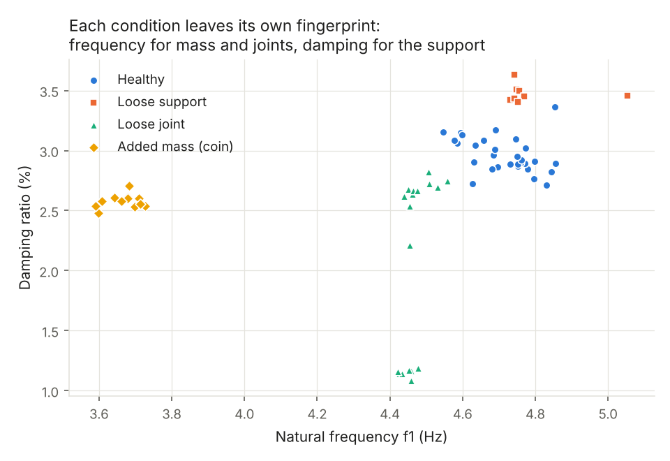
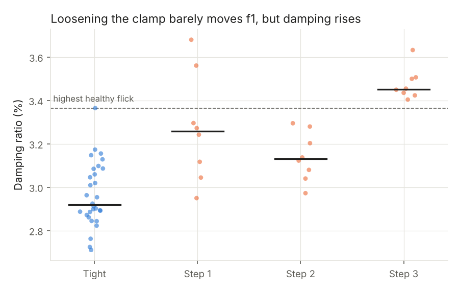
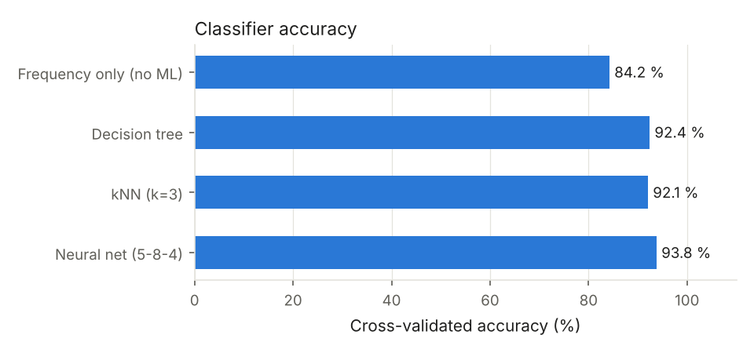
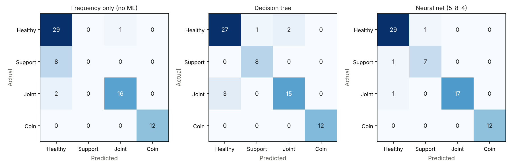
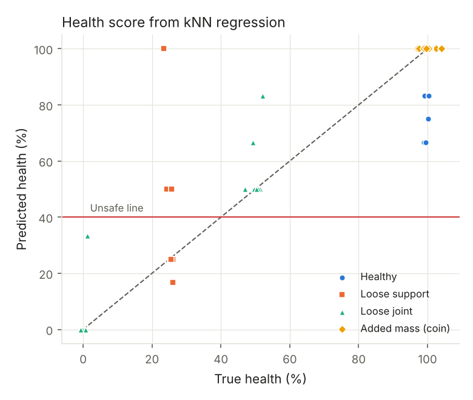
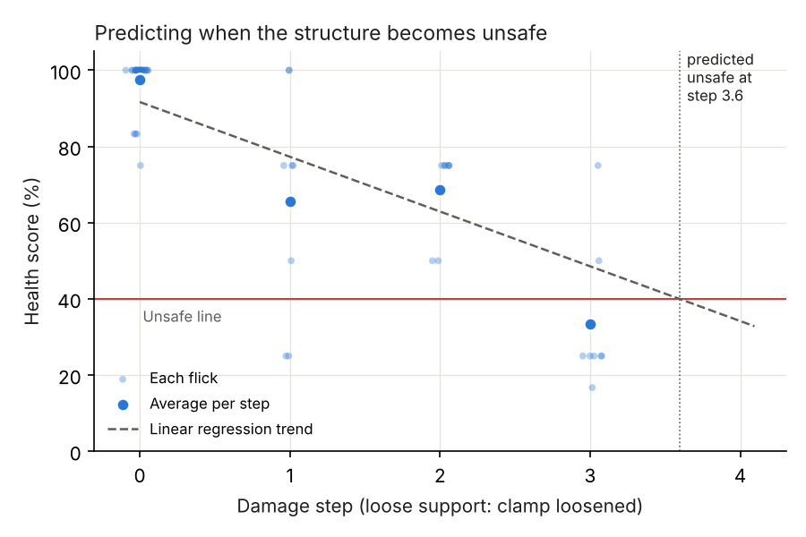
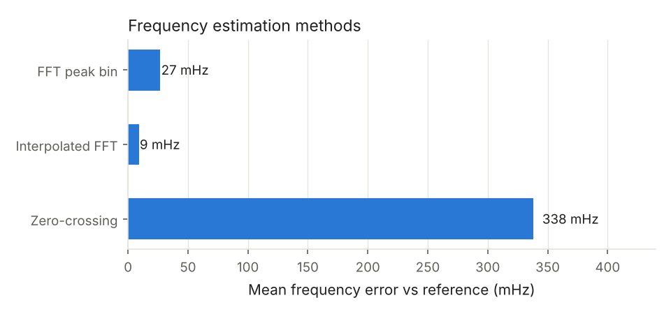

# Results on the real beam (lab, 28 October 2026)

All numbers below come from flicks recorded on the real beam and are
reproduced by the commands at the end. Plots are in `results/real/`.

## Setup used

| Item | Value |
|---|---|
| Beam | Two 30 cm steel rulers. Ruler A sticks out 18.5 cm past the table edge; ruler B overlaps A by 13.5 cm, held by 3 binder clips |
| Free length | about 35.5 cm from the table edge to the tip |
| Support | 10 inch screw G-clamp, foot at the table edge, cardboard pad |
| Sensor | MPU6050 (GY-521) near the tip, Z axis, +-4 g, 100 samples/s, 1024 samples per flick |
| Added mass | Rs 20 + Rs 5 coins, double-sided tape plus brown tape around the ruler |

## Data recorded

| Condition | What was done | Flicks | Median f1 | Median damping |
|---|---|---|---|---|
| Healthy | Clamp tight, 3 clips | 30 | 4.74 Hz | 2.92 % |
| Added mass | Rs 20 + Rs 5 near the tip | 12 | 3.68 Hz | 2.58 % |
| Loose joint 1 | Middle clip removed | 10 | 4.47 Hz | 2.67 % |
| Loose joint 2 | One end clip also removed | 8 | 4.45 Hz | 1.16 % |
| Loose support 1 | Clamp loosened about 1/4 turn | 8 | 4.71 Hz | 3.26 % |
| Loose support 2 | About 1/2 turn | 8 | 4.75 Hz | 3.13 % |
| Loose support 3 | Loosest the beam still holds (about 3/4 turn) | 8 | 4.75 Hz | 3.45 % |
| Re-check | Healthy beam after restoring the setup (not trained on) | 5 | 4.68 Hz | 2.95 % |

24 flicks recorded with the wrong ruler overlap (15 cm instead of 13.5 cm)
are kept in `data/bad_overlap/` and are not used.

## Main findings

1. **Each fault leaves its own fingerprint.** The coins drop f1 by 22 %, a
   loose joint by about 6 %. Loosening the support does not change f1 at all,
   but it raises damping, because the loosely held end loses energy through
   friction.
2. **Support loosening is only visible at the last step.** At 1/4 and 1/2
   turn the damping sits inside the healthy spread, so these two steps are
   kept out of training (`TRAIN_EXCLUDE` in `pc/config.py`). At the loosest
   step every flick is above the highest healthy flick (about +18 % damping).
   The screw clamp holds the ruler firmly until it is almost released.
3. **The ML beats the frequency-only rule** of the synopsis, because only the
   ML looks at damping.





## Classifier accuracy (5-fold cross-validation, repeated 5 times)

68 training flicks: 30 healthy, 12 added mass, 18 loose joint, 8 loose support.

| Method | Accuracy |
|---|---|
| Frequency only (synopsis rule) | 84 % (cannot see loose support at all) |
| Decision tree, depth 3 | 92 % |
| kNN, k = 3 | 92 % |
| Neural net, 5-8-4 | **94 %** |

The tree uses f1 for 71 % of its decisions and damping for 27 %.





Flicks kept out of training:

| Set | Neural net says | Flagged CHANGED |
|---|---|---|
| Re-check of healthy beam (5) | healthy 5/5 | 0/5 |
| Loose support 1/4 turn (8) | healthy 4, loose support 4 | 0/8 |
| Loose support 1/2 turn (8) | healthy 5, loose support 3 | 1/8 |

## Health score and trend

The kNN health score has an average error of **5.6 points** (straight-line
regression: 17.8 points). Average health per step of support loosening:
97, 66, 69 and 33 %. Fitting a line through steps 0 to 2 predicts the beam
becomes unsafe (health below 40 %) at step 3.6. In the lab it was already
unsafe at step 3, so the prediction is slightly late.





## Frequency methods, measured on the board (objective 5)

Accuracy against a 16x zero-padded FFT reference on all 89 flicks; times
measured on the LPC1768 with SysTick during recording.

| Method | Mean error | Worst error | Board time | Extra RAM |
|---|---|---|---|---|
| FFT peak bin | 0.027 Hz | 0.052 Hz | 116.9 ms | 8 KB |
| Interpolated FFT (used) | 0.009 Hz | 0.063 Hz | 116.9 ms | 8 KB |
| Zero-crossing | 0.34 Hz | 2.07 Hz | 4.2 ms | none |



## On the board

The retrained models are in `board/model.h` and `hex/TinySHM.hex`. The C code
gives the same features and answers as Python on all 89 flicks
(`PARITY OK`). Flash use is about 20 KB of the 32 KB Keil limit.

## Reproduce

```
py pc/build_dataset.py real
py pc/train.py real
py pc/check_c_parity.py real
py pc/rescore_log.py real
py pc/trend.py real --fault loose_support --upto 2
py pc/compare_methods.py real
py pc/llm_report.py real        # needs GROQ_API_KEY (or GEMINI_API_KEY) for the AI report
```
