**Team:** Sagnik Basu (240953528), Pranav Gaddam (240953548), Shobit Hegde (240953556)
**Guides:** Dr. G Pradeep Reddy and Pragya Jha, Assistant Professors, School of Computer Engineering, MIT Manipal
**Date:** October 2026

## 1. Summary of progress

We have built the complete software side of the system and tested it end to end on simulated vibration data. The LPC1768 now does much more than check whether the natural frequency has dropped. From every flick of the beam it extracts **five vibration features** and runs **six small machine-learning models on the chip itself**. Together they name the fault, give a 0 to 100 % health score, raise an alarm when the beam becomes unsafe, and flag faults they have never seen before. On the laptop we train these models, predict when the beam will become unsafe, and generate a written inspection report.

The firmware fits comfortably on the board: about **20 KB of flash** (Keil limit 32 KB) and about **12.4 KB of RAM** (the LPC1768 has 32 KB of main RAM, 64 KB in total). The next stage is recording real flicks on the beam and retraining the same pipeline on them.

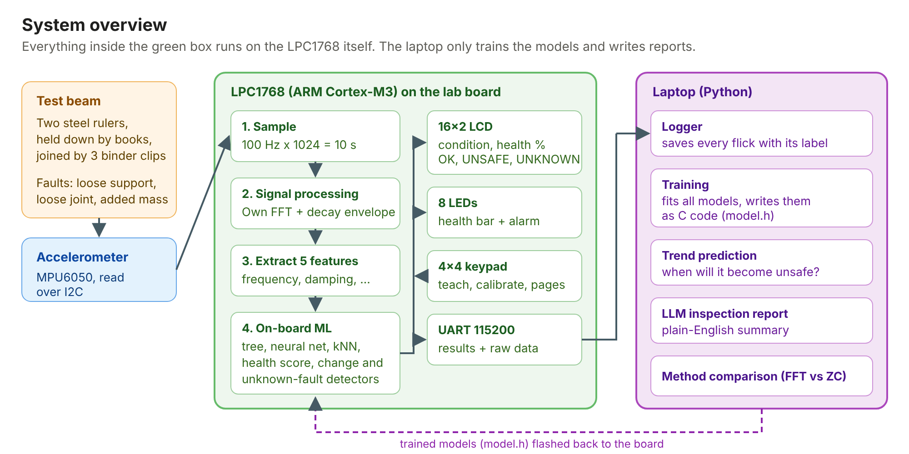

## 2. What we have added beyond the synopsis

| Area | In the synopsis | What we have now |
|---|---|---|
| Decision method | Alarm when the frequency drops by more than about 3 % | Machine learning on 5 features: decision tree, kNN and a neural network, plus a health score, change detector, unknown-fault detector and on-the-spot learning |
| Features | Natural frequency only | Natural frequency, damping, amplitude, energy ratio (rattle) and decay time |
| FFT | CMSIS-DSP library | Our own radix-2 FFT in plain C with parabolic peak interpolation, checked against NumPy |
| Sensor | ADXL335 (analog, 12-bit ADC) | MPU6050 over I2C: 16-bit readings (about 22 times finer), built-in 44 Hz filter, and the board can detect a wiring fault |
| Output | LED alarm and UART | 8-LED health bar and alarm, 16x2 LCD, 4x4 keypad menu, and full results over UART |
| Frequency methods (objective 5) | Compare FFT and zero-crossing | Three methods implemented on the board and timed with SysTick, with accuracy compared on the laptop |
| PC side | Plotting | Complete Python pipeline: logging, training, plots, C/Python verification, trend prediction and an AI-written report |

## 3. The test setup

The beam is two 30 cm steel rulers. Ruler A sticks out 10 cm past the table edge and is held down by a stack of four heavy books placed flush with the edge, and ruler B overlaps it by 5 cm, held with three binder clips. This gives a 35 cm cantilever with a natural frequency of roughly 7 Hz. The accelerometer is taped 2 cm from the tip. No drilling, cutting or clamping hardware is needed, and every fault can be undone:

- **Loose support:** take books off the stack one at a time (damage steps 1, 2, 3), so the fixed end is held less firmly.
- **Loose joint:** remove binder clips one by one.
- **Added mass:** tape a coin near the tip. This is not damage, and the system must tell it apart from real damage.

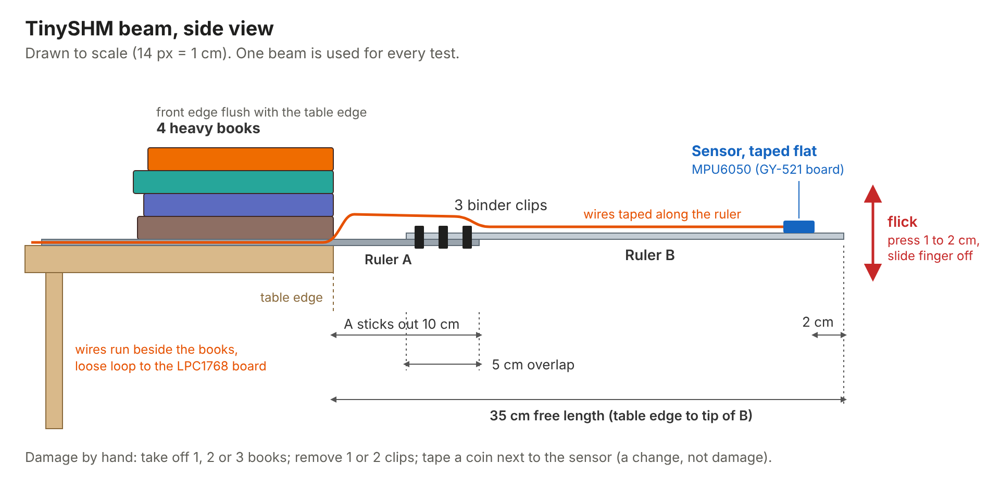

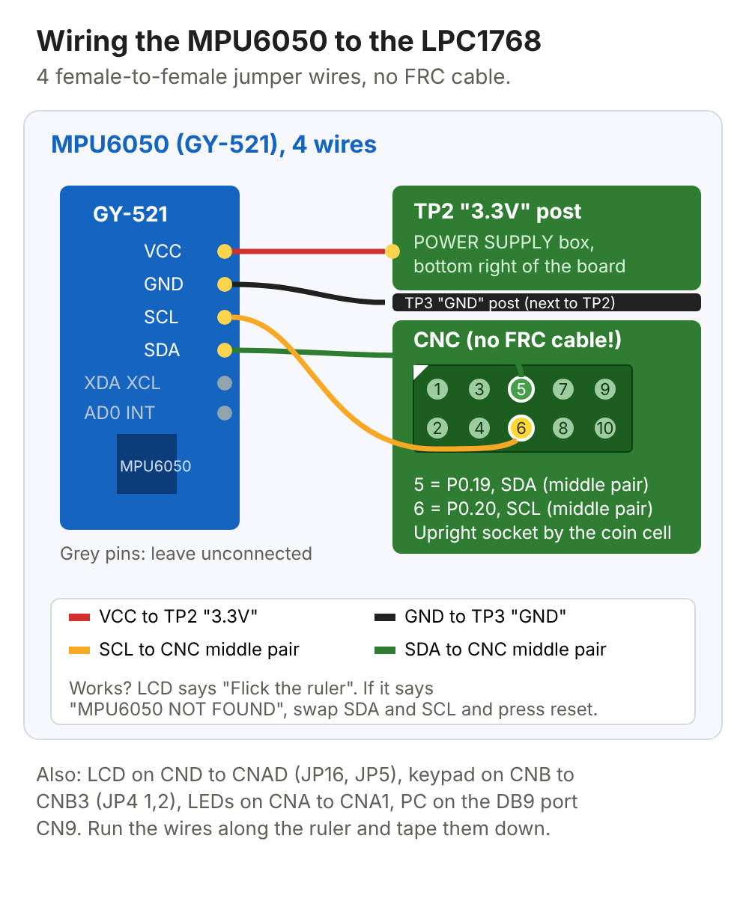

## 4. How the system works

### 4.1 From a flick to five numbers

When the beam is flicked, the board samples the accelerometer at 100 Hz for 1024 samples (about 10 s). The beam rings at its natural frequency and slowly dies away. The board then computes five features:

| Feature | What it measures | How it is computed on the board |
|---|---|---|
| **f1** | Natural frequency (Hz) | Hann window, our own 1024-point FFT, peak between 3 and 40 Hz, refined by parabolic interpolation |
| **Damping** | How quickly the vibration calms down | Slope of the log of the RMS envelope (0.25 s windows), divided by 2πf1 |
| **Amplitude** | How hard the beam was flicked (g) | Largest absolute value after removing the offset |
| **Energy ratio** | Rattle: energy outside the main peak | Spectral energy more than 1 Hz from the peak, divided by the total |
| **Decay time** | Seconds until the vibration fades | Time from the loudest window until the RMS falls below 10 % |

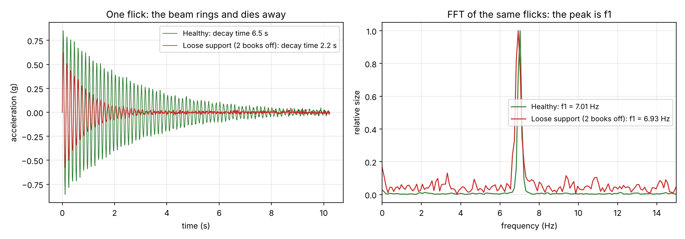

The plot shows why frequency alone is not enough. A loose support moves f1 by only about 1 % (7.01 Hz to 6.93 Hz), but the decay time falls from 6.5 s to 2.2 s, because the loosely held end loses energy through friction. Damping and decay time make the fault obvious.

### 4.2 The on-board machine learning

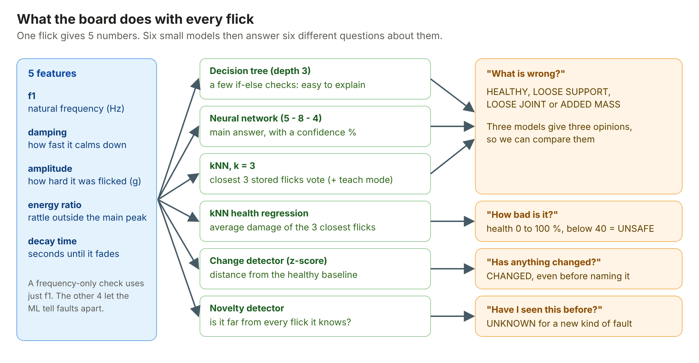

All six models run on the LPC1768. The laptop only trains them and writes them into `model.h` as plain C arrays and if-else code, which is compiled into the firmware.

1. **Decision tree (depth 3).** A short chain of if-else checks, such as "decay time ≤ 3.9 s and f1 ≤ 6.65 Hz → loose joint". It is easy to explain and shows which features matter most. In our tree, decay time carries 65 % of the decisions and frequency 35 %.
2. **Neural network (5 inputs, 8 hidden, 4 outputs).** The features are scaled, passed through 8 ReLU neurons, and a softmax gives the class with a confidence percentage. It has 84 weights, under 1 KB.
3. **k-nearest neighbours (k = 3).** The board stores the scaled features of every training flick. A new flick is compared with all of them, and the 3 closest vote. This gives a second opinion and is the basis of teach mode.
4. **Health score (kNN regression).** Every training flick has a known damage level. The health score is 100 % minus the average damage of the 3 closest flicks. Below 40 % the board shows **UNSAFE** and all LEDs flash.
5. **Change detector.** The board keeps the mean and spread of each feature for the healthy beam. If a new flick is more than 3 standard deviations away on average (RMS z-score), it shows **CHANGED**, even before it can name the fault.
6. **Unknown-fault detector.** If a flick is far from every flick the board has seen (nearest-neighbour distance above a threshold learned in training), it shows **UNKNOWN** instead of forcing a wrong label.

Two features let the board keep learning without a laptop:

- **Teach mode (key A):** five flicks of a new condition are stored in RAM as a new kNN class.
- **Self-calibration (key C):** ten flicks of the healthy beam replace the stored healthy baseline, so the system adapts if the setup is rebuilt.

### 4.3 On the laptop

- **Training** (`train.py`) fits all the models, compares them, makes the plots and writes `board/model.h`.
- **Verification** (`check_c_parity.py`) runs the board's C code and the Python code on the same flicks and confirms they give the same answers.
- **Trend prediction** (`trend.py`) fits a line through the health score across damage steps and predicts at which step the beam crosses the unsafe line.
- **Inspection report** (`llm_report.py`) sends the measured numbers to a large language model (Groq, with Gemini as backup) and gets back a plain-English engineer's report.

## 5. Results so far (simulated data)

These results use 121 simulated flicks generated from the physics of a damped cantilever, so the whole pipeline could be built before the hardware arrived. They will be repeated with real flicks.

### 5.1 Classification accuracy

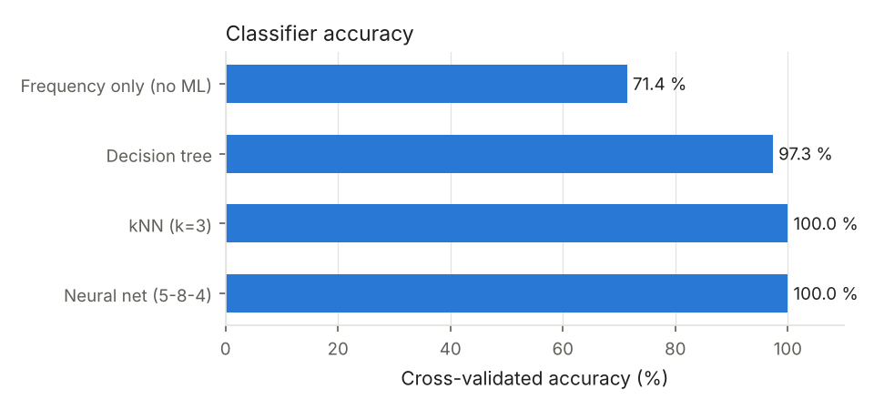

| Method | Accuracy |
|---|---|
| Frequency only (the synopsis rule) | 71 % |
| Decision tree | 97 % |
| kNN (k = 3) | 100 % |
| Neural network | 100 % |

The frequency-only method fails mainly on the coin. Added mass lowers the frequency just like damage does, so a frequency rule calls it damage. The ML models also look at damping and rattle, which the coin does not change, so they label it **ADDED MASS** and keep the health score high.

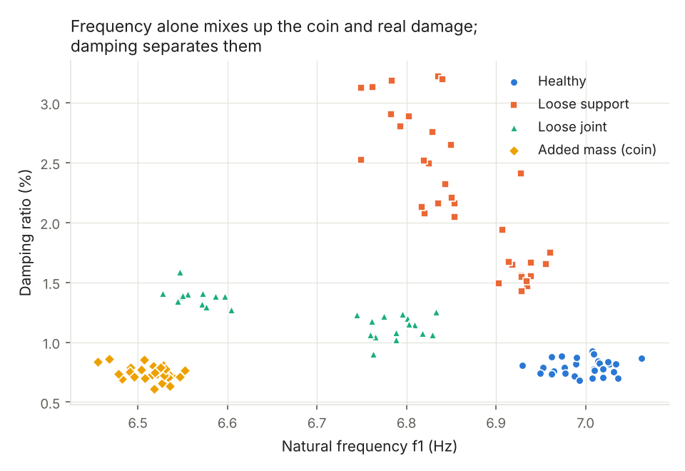

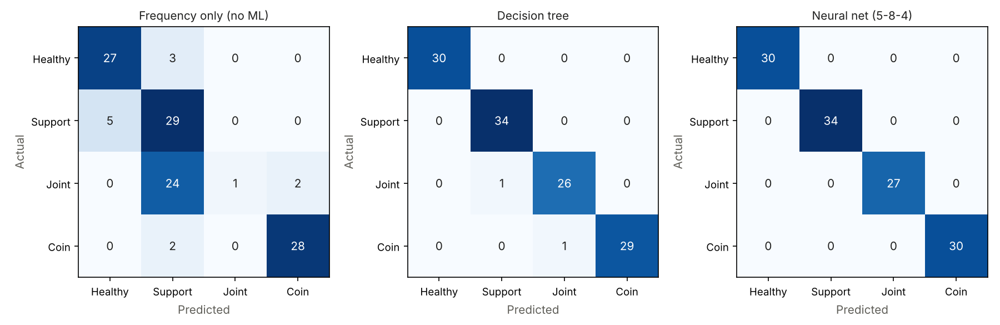

### 5.2 Health score and trend

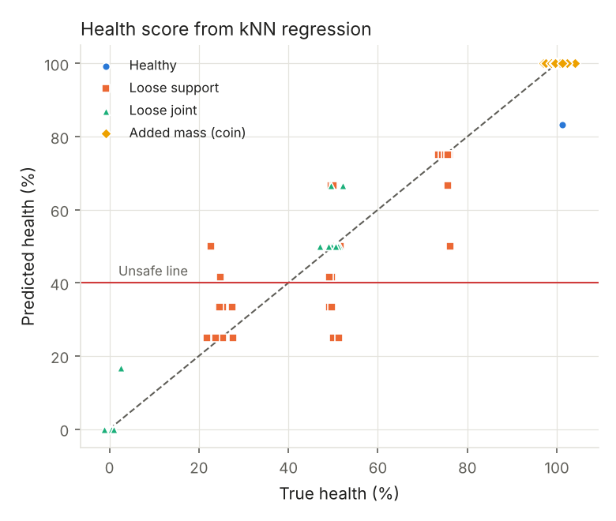

The kNN health score has an average error of 2.6 points (a plain linear regression gives 12.7).

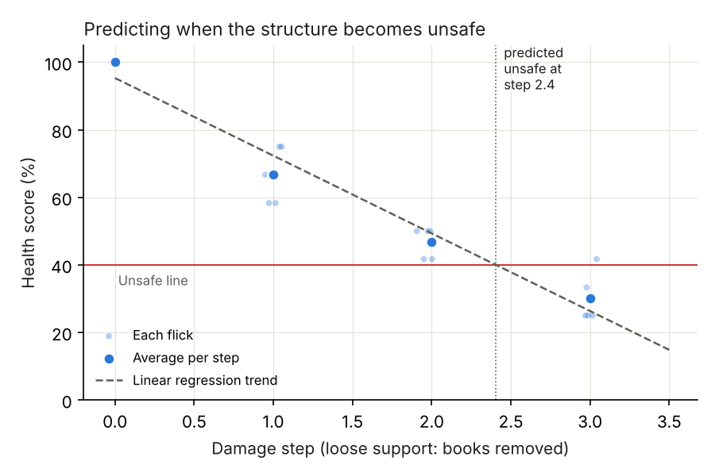

As books are taken off one at a time, health falls by about 23 points per book, and the trend predicts that the beam becomes unsafe at step 2.4.

### 5.3 Unknown faults

We tested 20 flicks of combined faults that the models never saw in training. All 20 were flagged as **CHANGED**, and 9 of 20 were flagged as **UNKNOWN**.

### 5.4 Frequency estimation methods (objective 5)

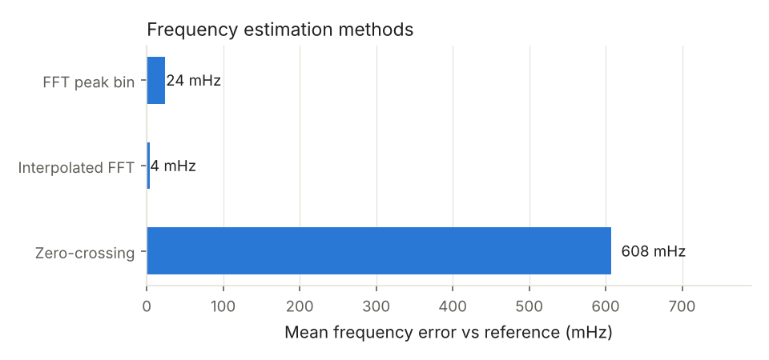

| Method | Mean error | Worst error | Extra RAM |
|---|---|---|---|
| FFT peak bin | 0.024 Hz | 0.048 Hz | 8 KB |
| Interpolated FFT | 0.004 Hz | 0.027 Hz | 8 KB |
| Zero-crossing | 0.61 Hz | 4.28 Hz | none |

The interpolated FFT costs almost nothing over the plain FFT and is about 7 times more accurate, so it is the method we use. Zero-crossing needs no buffers, but it is far too inaccurate to see a change of a few percent. The board times all three methods with the SysTick timer after every flick, and the real timings will be added from the lab runs.

### 5.5 Fit on the LPC1768

| Resource | Used | Available |
|---|---|---|
| Flash (code + models) | about 20 KB | 32 KB (Keil uVision 4 limit), 512 KB on the chip |
| RAM | about 12.4 KB | 32 KB main RAM (64 KB in total) |
| Largest RAM users | FFT buffers 8 KB, samples 2 KB | |

The C code on the board gives the same features and answers as the Python code on every test flick (`PARITY OK`).

## 6. Hardware connections on the lab board

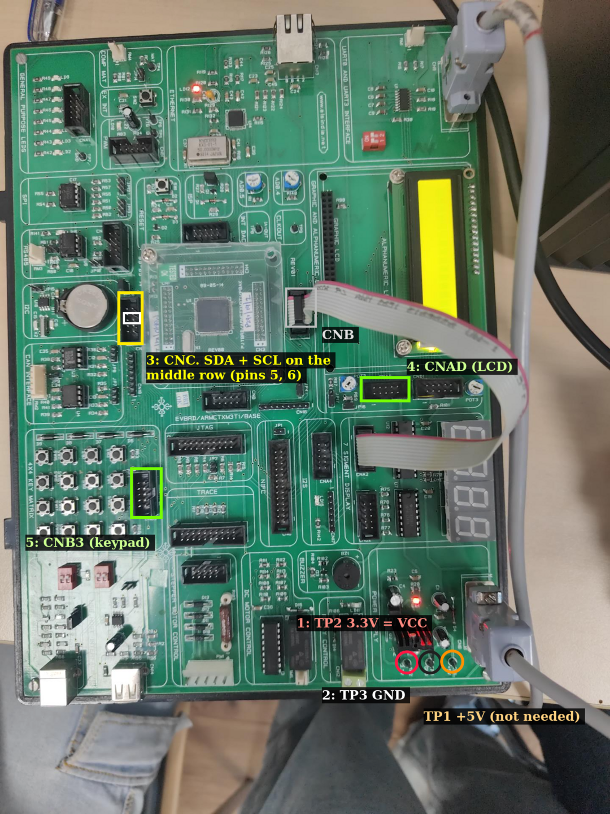

| Item | Connection |
|---|---|
| MPU6050 SDA / SCL | P0.19 / P0.20 (I2C1), middle pair of connector CNC |
| Sensor power | TP2 (3.3 V) and TP3 (GND) |
| LCD | FRC cable CND to CNAD |
| Keypad | FRC cable CNB to CNB3 |
| LEDs | FRC cable CNA to CNA1 (P0.4 to P0.11) |
| PC | DB9 cable to CN9, 115200 baud |

## 7. Next steps

1. Build the beam and wire the sensor to the board.
2. Record about 120 real flicks across all conditions and damage steps.
3. Retrain on the real data, flash the new model and repeat every result above.
4. Add the measured SysTick timings to the method comparison.
5. Write the final report with the real results.
